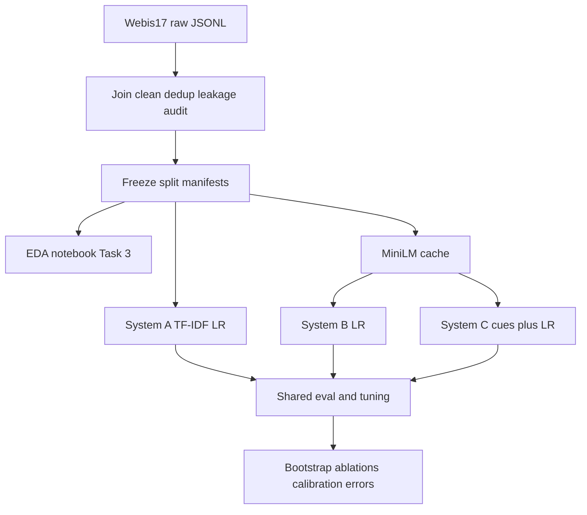

# Implementation plan — Clickbait Without the Click

Phased plan for **building and running** the project (not the same as course Phase 1–3 checkpoints).

## Context

- **Ground truth:** [`nlp_proposal_v2.tex`](nlp_proposal_v2.tex), [`AGENTS.md`](AGENTS.md).
- **Repo:** course docs + proposal; experiment pipeline grows task by task (see Progress below).
- **Research hinge:** paired **C − B** macro-F₁ on **temporal** test (main: train Dec–Feb, val Mar, test Apr); identical split IDs for A/B/C; logistic regression with `class_weight='balanced'`; regularization **C** tuned by randomized search on **validation macro-F₁**.
- **Constraint:** at most **10** LLM coding tasks; heavy runs (embedding cache, full suites) on a **GPU VM** or shared machine as needed.
- **Executor** = who runs the LLM agent and **commits**; **Support** = data download, GPU, review, sign-off. Adjusted from the Phase-1 proposal so **Hubert can start Tasks 1–2** before classical/cues (Task 4).

---

## Progress (update after each task)

Mark tasks when merged to the team branch. Agents: see [`AGENTS.md`](AGENTS.md) — update this list when a task is finished.

- [x] **Task 1** — Scaffold + config (Hubert)
- [x] **Task 2** — Dataset + splits (Hubert · Adam support)
- [ ] **Task 3** — EDA notebook (Mateusz · Adam support)
- [x] **Task 4** — 12 cues + System A (Hubert · Adam support)
- [x] **Task 5** — MiniLM cache script (Igor · Mateusz support)
- [x] **Task 6** — Systems B and C (Igor · Mateusz support)
- [ ] **Task 7** — PoC runner (Mateusz · Igor support)
- [ ] **Task 8** — Full experiment orchestrator (Mateusz · Hubert support)
- [ ] **Task 9** — Analysis scripts (Mateusz · Hubert support)
- [ ] **Task 10** — Webis-16 stub + README repro (Adam · Igor verify)

---

## Blocking necessary human input

Hard prerequisites for agent or merge work on the **Blocks** task. Check when done; add rows if new blockers appear.

| Done | Who | Blocks | Required action |
|:----:|-----|--------|-----------------|
| [ ] | **Adam** | Task 2 | Skim-review [`configs/experiment.yaml`](configs/experiment.yaml): `webis17.instances` / `webis17.truth` match your Zenodo unpack paths (`data/raw/instances.jsonl`, `data/raw/truth.jsonl` or adjust YAML). |
| [x] | **Adam** | Task 2 | Download Webis-Clickbait-17 `clickbait17-train-170630.zip` from Zenodo → unzip under `data/raw/` (not committed; gitignored). *(Done locally for pipeline run; other clones still need the zip.)* |
| [ ] | **Adam** | Task 2 | Review and **sign off** article-overlap / leakage policy in [`docs/data.md`](docs/data.md) before treating `splits/*.json` as frozen. |
| [x] | **Hubert** | Task 2 | Run `build_dataset` / `build_splits` locally once Adam’s data is in place; commit manifests. |
| [ ] | **Adam** | Task 3 | By ~20 Nov: add Webis-16 under `data/raw/webis16/` **or** send Mateusz one sentence (“not available because …”) for the EDA notebook. |
| [x] | **Igor** | Tasks 6–7 | Full CPU cache shared; Mateusz confirmed the same `--check` result. Measured runtime and memory are saved in [`results/embedding_cache_time.txt`](results/embedding_cache_time.txt). |
| [x] | **Igor** | Task 7 | B/C trained on `temporal_main`; frozen April metrics and paired predictions are in [`results/bc_temporal_main_test.json`](results/bc_temporal_main_test.json). |
| [ ] | **Mateusz** | Task 7 | Execute `run_poc.py`; provide slide table (split name, macro-F₁ A/B/C, C−B). |
| [ ] | **Mateusz** | Task 8 | Run full experiment suite; archive one `results/runs/` folder for reproduction. |
| [ ] | **Adam** | Task 10 | Fresh-clone README reproduction check (or document fix if it fails). |
| [ ] | **Igor** | Task 10 | Confirm reproduced PoC numbers match pinned `results/poc_summary.json`. |

**Currently on the critical path:** Adam’s YAML review + **sign-off** on article dedupe policy (`docs/data.md`) → Mateusz Task 3 EDA.

---

Use in the Phase 2 report if the team agrees (same workstreams; shifted **who commits** early pipeline code):

| Workstream | Owner | Support | Adjustment |
|------------|-------|---------|------------|
| Data and protocol | Adam | Igor | **Hubert commits** Tasks 1–2; Adam owns Zenodo download, leakage sign-off, Webis-16 |
| Classical NLP and cues | Hubert | Adam | Unchanged; Task 4 after Task 2 |
| Neural NLP and hybrid | Igor | Mateusz | Unchanged; Tasks 5–6 |
| Evaluation and analysis | Mateusz | Hubert | Dedicated **Task 3 EDA**; Tasks 7–9 |

LaTeX for report (drop-in replacement for `tab:roles` body — keep caption/label or add a footnote on commit roles):

```latex
\begin{tabularx}{\columnwidth}{@{}p{1.85cm}p{1.18cm}p{1.14cm}X@{}}
\toprule
Workstream & Owner & Support & Main output\\
\midrule
Data and protocol & Adam & Igor & Clean joins, leakage-safe splits, external data; \emph{implementation Tasks 1--2: Hubert (commits), Adam (data + review)}\\
Classical NLP and cues & Hubert & Adam & TF--IDF baseline, cue definitions/ablations\\
Neural NLP and hybrid & Igor & Mateusz & Frozen MiniLM, embedding and hybrid models\\
Evaluation and analysis & Mateusz & Hubert & EDA notebook, metrics, uncertainty, errors, reproduction\\
\bottomrule
\end{tabularx}
```

---

## Target repo layout

```text
pyproject.toml
uv.lock
configs/experiment.yaml
data/raw/                 # gitignored — Zenodo archive
data/processed/           # cleaned posts table
splits/                   # immutable JSON manifests
cache/embeddings/         # gitignored
src/
scripts/
notebooks/eda.ipynb       # Task 3 — course-required EDA
docs/cues.md
resources/                # lexicon files for cues
results/
```



---

## Phase 1 — Repository scaffold and reproducibility baseline

**Goal:** Anyone can install deps with **uv**, load config paths/seeds — no data required.

### Task 1 — LLM agent · **Executor: Hubert** · Support: **Adam**

**Agent should:**

- Add dependencies with `uv add` (scikit-learn, sentence-transformers, torch, numpy, pandas, matplotlib, pyarrow or jsonlines); commit `pyproject.toml` and `uv.lock` (no `requirements.txt`).
- Add `configs/experiment.yaml`: `random_seed`, paths (`data/raw`, `data/processed`, `splits/`, `cache/`), model id `sentence-transformers/all-MiniLM-L6-v2`, LR `class_weight: balanced`, randomized-search `n_iter` and `C` distribution (single validation fold per split, not k-fold CV).
- Add `.gitignore`: `data/raw/`, `cache/`, `__pycache__/`, `.venv/`, large local artifacts.
- Keep README environment section aligned with uv; full experiment reproduction deferred to Task 10.
- Minimal `src/` layout and smoke test: `uv run python -c "…"` loads config.

**Done when:** `uv sync` succeeds; config loads without error.

**Human — Hubert:** Run this task first; commit as primary author.

**Human — Adam (Support):** Skim-review YAML paths against Webis-17 unpack layout (`instances.jsonl`, `truth.jsonl`) before Task 2.

---

## Phase 2 — Data ingestion, cleaning, and split manifests

**Goal:** Frozen dataset row set + named splits matching the proposal (temporal windows + random grouped diagnostics).

### Task 2 — LLM agent · **Executor: Hubert** · Support: **Adam** (data + protocol)

Implement per proposal § Data and § Evaluation:

1. **Load** `instances.jsonl` + `truth.jsonl`, join on ID; keep `postText`, binary `truthClass`, timestamp (month for temporal splits), fields for **article overlap** (document which schema field is used in code or `docs/data.md`).
2. **Clean:** drop empty teasers; dedupe normalized nonempty teasers (keep **earliest** timestamp); log counts (expect ~19,073 before overlap rules per proposal audit: 54 empty, 411 repeated occurrences).
3. **Leakage:** detect shared article content across would-be train/val/test; policy in code (e.g. assign all posts sharing an article ID to one partition or drop — **Adam signs off**); audit counts feed Task 3 EDA.
4. **Splits (JSON under `splits/`):**
   - **Temporal expanding windows (3):** Dec→Jan→Feb; Dec–Jan→Feb→Mar; Dec–Feb→Mar→Apr (**`temporal_main`**).
   - **Random grouped (3 seeds):** group by normalized teaser and/or article; no group crosses train/val/test; stratified ratios in manifest metadata.
5. Export `data/processed/posts.parquet` (or `.csv`) with stable `post_id`.
6. CLI: `scripts/build_dataset.py`, `scripts/build_splits.py`.

**Done when:** Scripts run on local data; manifests committed; README notes regeneration commands.

**Human — Adam (Support):**

- Download Webis-Clickbait-17 Zenodo archive `clickbait17-train-170630.zip` into `data/raw/` and unzip.
- Review leakage policy with Hubert before freezing manifests.

**Human — Hubert (Executor):**

```bash
uv run python scripts/build_dataset.py
uv run python scripts/build_splits.py
```

- Commit: `splits/*.json`, loader/split code, processed metadata or ID-only exports if full parquet is too large (document in README).
- Notify Mateusz when Task 2 is merged for Task 3.

**Gather for Phase 2 report:** table of N and positive rate overall and **per split**; dedupe and overlap counts.

> **Course checkpoint:** Tasks 1–2 and frozen splits must land **before** EDA (Task 3) and before mid-term model training (Tasks 4–7). Target week: **5–11 Nov** (proposal).

---

## Phase 3 — Exploratory data analysis (course requirement)

**Goal:** Satisfy Phase 2 criterion **2.2** explicitly — not bundled into PoC.

**Required content (project rules / assessment):** label and length distribution; duplicates; **leakage check between splits**; comparison with **at least one other dataset** (Webis-16) **or one clear sentence why not**.

### Task 3 — LLM agent · **Executor: Mateusz** · Support: **Adam**

**Agent should:**

- **`notebooks/eda.ipynb`** (optional `scripts/eda_export.py` → `results/eda_summary.json`):
  1. **Labels:** class balance overall and **by calendar month** (temporal drift).
  2. **Length:** token/character counts for `postText`; summary stats and histograms by class.
  3. **Duplicates:** empty teasers removed; normalized teaser collisions; compare to proposal audit figures.
  4. **Leakage across splits:** for each named manifest, cross-split violations (duplicate teasers, shared article groups); tables for the Phase 2 report with **split names on every row**.
  5. **Other dataset:** if `data/raw/webis16/` exists — compare N, label rate, length, field mapping; else **one prominent sentence** in the notebook: why Webis-16 is not compared yet (collection pending per proposal).
- Export figures to `results/figures/eda_*`.

**Human — Mateusz:**

```bash
uv run jupyter notebook notebooks/eda.ipynb
# or: uv run jupyter nbconvert --execute notebooks/eda.ipynb
```

- Commit notebook + figures + `eda_summary.json` if used.
- **Gather for report:** EDA subsection with self-contained figure captions; every table states scope/split.

**Human — Adam (Support):** By ~20 Nov, provide Webis-16 under `data/raw/webis16/` or written “not available” text for notebook §5.

> **Course checkpoint (2 Dec — Phase 2 report, criterion 2.2):** EDA notebook is a **graded deliverable**. It must be in the merge request even if Webis-16 comparison is deferred with an **explicit one-sentence justification**.

---

## Phase 4 — Twelve linguistic cues + classical baseline (System A)

**Goal:** Prespecified 12 numeric cues + end-to-end **A** with train-only preprocessing; **C** tuned on validation macro-F₁.

### Task 4 — LLM agent · **Executor: Hubert** · Support: **Adam**

**Agent should:**

1. **`src/cues.py`:** exactly **12** features in three groups (proposal): length/word structure; punctuation/capitalization; pronoun/forward-reference lexicons (`resources/*.txt`). Document in `docs/cues.md`.
2. **`src/models/system_a.py`:** word 1–2 + char 3–5 TF–IDF, L2 LR, `class_weight='balanced'`.
3. **`src/tuning.py`**, **`src/metrics.py`:** randomized search on val macro-F₁ for `C` only; report macro-F₁, P/R/F₁, AP, Brier, confusion matrix. Document protocol: select `C` on validation, fit on train (or train+val if team fixes that in config), report **test** without peeking.
4. CLI: `scripts/train_system_a.py --split temporal_main` (and other manifest names).

**Done when:** `results/system_a_<split>.json` includes split name, tuned `C`, test metrics.

**Depends on:** Task 2. Task 3 EDA can run **in parallel** on the same processed data.

**Human — Hubert:**

```bash
uv run python scripts/train_system_a.py --split temporal_main
```

- **Report:** cite split name on every metric row (supports 2.3 experiment plan for system A).

---

## Phase 5 — Frozen MiniLM cache (System B prerequisite)

**Goal:** One embedding cache reused by B and C; encoder frozen, never retrained.

### Task 5 — LLM agent · **Executor: Igor** · Support: **Mateusz**

**Agent should:**

- `scripts/cache_embeddings.py`: `all-MiniLM-L6-v2`, batch encode, save by `post_id` (npz/memmap + id index); `cache/embeddings/meta.json` (package versions from `uv.lock`, batch size, device).

**Incremental progress:**

- [x] ID-indexed cache, round-trip tests, and a seeded 64-post CPU pilot on `temporal_main` training data. Five independently re-encoded posts agree within float32 tolerance.
- [x] Full-dataset encoding, model/input compatibility checks, and runtime/memory measurement. All 18,682 processed posts and six manifests pass validation; [run summary](results/embedding_cache.json) and [GNU time log](results/embedding_cache_time.txt) record the CPU run.
- [x] Complete cache shared with Mateusz, who confirmed the same successful result from `uv run --locked python scripts/cache_embeddings.py --check`: 18,682 embeddings verified and six split manifests covered.

**Human — Igor (CPU or GPU machine):**

1. Sync repo + `data/processed/` to the execution machine; keep the cache gitignored and share it through team storage or rsync.
2. Run the full cache under `/usr/bin/time -v` on the chosen device; use the [README commands](README.md#frozen-minilm-cache-task-5) for generation, measurement, and validation. `--sample-size` selects a separate training-only pilot.
3. Verify five random IDs → embedding shape `(384,)`.
4. **Gather for report (criterion 2.7):** paste **measured** wall time and max RSS from `time -v` — not estimates.

> **Course checkpoint (18 Nov — mid-term PoC):** Embedding cache should exist by **~11 Nov** (proposal week) so Tasks 6–7 can report B/C numbers.

---

## Phase 6 — Neural baselines B and C

**Goal:** B = embeddings + LR; C = embeddings + train-fitted scaled cues + LR; same tuning protocol as A.

### Task 6 — LLM agent · **Executor: Igor** · Support: **Mateusz**

**Agent should:**

- Load cache by `post_id`; fail fast if missing.
- `StandardScaler` on cues (train only); concatenate for C.
- Same randomized **C** search on validation macro-F₁ as A.
- CLI: `scripts/train_neural.py --system B|C` (or separate scripts).

**Incremental progress:**

- [x] ID-aligned float64 B/C feature construction and train-only cue scaling. Unit tests and `scripts/check_neural_features.py --split temporal_main` verify the training/validation matrices, embedding equality, and cue order.
- [x] Shared tuning history and convergence handling; B training/validation runner with model and prediction exports. All 25 candidates converged on CPU; `temporal_main/val` macro-F₁ is 0.716718. The [summary](results/system_b_temporal_main_validation.json) and [GNU time log](results/system_b_temporal_main_validation_time.txt) record the run; reloading the classifier reproduces the exported predictions and probabilities exactly.
- [x] C training through the shared protocol; fitted cue scaler, classifier and prediction exports. All 25 candidates converged on CPU; `temporal_main/val` macro-F₁ is 0.745811. The [summary](results/system_c_temporal_main_validation.json) and [GNU time log](results/system_c_temporal_main_validation_time.txt) record the run. Saved scaler statistics match the training cues; the reloaded pipeline reproduces exported probabilities exactly. B/C input hashes, validation IDs and tuning settings agree.
- [x] Frozen `temporal_main` B/C evaluation, measured runtime/memory, and README reproduction commands. The [protocol and models](results/frozen/temporal_main/protocol.json) were committed before April scoring. On 3,580 `temporal_main/test` posts, macro-F₁ is B = 0.710541 and C = 0.737422; paired C−B = +0.026881. The [summary](results/bc_temporal_main_test.json), [paired predictions](results/bc_temporal_main_test_predictions.parquet) and [GNU time log](results/bc_temporal_main_test_time.txt) record the result. Direct LR/scaling calculations reproduce every prediction and probability; all 35 tests pass.

**Human — Igor:**

```bash
uv run --locked python scripts/train_neural.py --system B --split temporal_main
uv run --locked python scripts/train_neural.py --system C --split temporal_main
uv run --locked python scripts/evaluate_neural.py
```

Training commands evaluate validation only. The evaluator uses the committed frozen models
and produces April test metrics and paired predictions without fitting. This completes
Task 6 for the current manifest and title-based article proxy; Adam's policy review remains
pending above. Next: Task 7 PoC integration, then Tasks 8–9 experiments and analysis.

---

## Phase 7 — Proof-of-concept runner (mid-term numbers)

**Goal:** Course **2.1** — end-to-end PoC on real data with at least **one reported number** (code-only or number-only → half credit).

### Task 7 — LLM agent · **Executor: Mateusz** · Support: **Igor**

**Agent should:**

- **`scripts/run_poc.py`:** run A, B, C on **`temporal_main`** (optional second split); write `results/poc_summary.json` and a markdown table for slides.

**Depends on:** Task 4 (A), Task 5 (cache), Task 6 (B/C).

**Human — Mateusz (lead) + team:**

```bash
uv run python scripts/run_poc.py
```

- Slides/video: **split name**, macro-F₁ for A/B/C, point estimate **C−B**.

> **Course checkpoint (18 Nov):** Mandatory **mid-term presentation** + **10-minute video** (SOTA recap + PoC **pipeline** + at least one result). Live demo from loader through one trained split is acceptable.

> **Course checkpoint (13 Nov):** Mandatory **proposal feedback** meeting — no repository deliverable.

> **Course checkpoint (25 Nov):** Individual **Q&A questions** for other teams (§5a, up to 5 pts) — prepare during or after mid-term.

---

## Phase 8 — Full experiment matrix and measurement

**Goal:** All temporal windows + random grouped splits; **measured** runtime/memory; `--repeat 3` for Phase 3 spread.

### Task 8 — LLM agent · **Executor: Mateusz** · Support: **Hubert**

**Agent should:**

- `scripts/run_experiments.py --suite main`: all split manifests, systems A/B/C; log validation-best `C`, test macro-F₁ and secondary metrics; **wall time** and **peak RSS** per run.
- Save predictions for Task 9, e.g. `results/runs/<timestamp>/predictions_<system>_<split>.parquet` (document exact names in script help).
- Output: `results/runs/<timestamp>/metrics.jsonl` + aggregated CSV.

**Human — Mateusz (lead):**

```bash
/usr/bin/time -v uv run python scripts/run_experiments.py --suite main
# Phase 3 final: uv run python scripts/run_experiments.py --suite main --repeat 3
```

- Archive one run directory for Adam’s reproduction check (Task 10).
- **Gather for report:** one table per **named split**; spread across the three temporal windows; contrast random vs temporal diagnostics.

> **Course checkpoint (2 Dec — Phase 2 submission):** Merge request with source code; **EDA (2.2) + PoC (2.1)**; experiment plan in report **(2.3)**; README reproduction **(2.6)** — Task 10 may land the same week; **measured** runtime/memory **(2.7)** not estimates; contribution table **(2.8)** + LLM declaration + rebuttals **(2.4)**; submission folder `kolodziej_kowalski_kaniasty_iwaniuk` (order fixed at Milestone 1).

---

## Phase 9 — Analysis layer

**Goal:** Proposal evaluation plan for Phase 3: paired **C−B** uncertainty, cue ablations, calibration, error analysis.

### Task 9 — LLM agent · **Executor: Mateusz** · Support: **Hubert**

**Agent should:**

- **`scripts/bootstrap_paired.py`:** paired bootstrap on **April test** (`temporal_main`) for C−B macro-F₁ CI.
- **`scripts/ablate_cues.py`:** drop cue groups (length / punctuation / lexicon) one at a time on system C.
- **`scripts/calibration_plots.py`:** reliability diagrams + Brier for B vs C on main test.
- **`scripts/export_errors.py`:** export at least **20** misclassified examples with text, gold label, A/B/C predictions; include **model disagreement** cases and **annotator-agreement strata** when available from truth fields; heuristic category column for manual refinement.
- Figures under `results/figures/`.

**Human — Mateusz / Hubert:** Run after Task 8 predictions exist; refine named error categories in exported CSV for the final report (≥20 categorized errors required for Phase 3).

**Gather for report:** bootstrap CI wording for abstract; ablation table with split named; self-contained calibration captions.

---

## Phase 10 — Secondary corpus, README reproduction, freeze

**Goal:** Webis-16 transfer diagnostic; stranger reproduces **one** pinned result from README alone.

### Task 10 — LLM agent · **Executor: Adam** · Support: **Igor** (repro verify)

**Agent should:**

- **`scripts/eval_webis16.py`:** train on Webis-17 main train only, evaluate on Webis-16 if present; else skip with documented message (transfer diagnostic, not second training corpus).
- **README:** data download, `uv sync`, build dataset/splits, cache embeddings, **one command** reproducing pinned `results/poc_summary.json` (or equivalent); cite `uv.lock`, Python version, seed.

**Human — Adam:**

- Place Webis-16 under `data/raw/webis16/` or document absence in the Phase 2 report.
- Fresh clone: follow README only; Igor confirms numbers match.

> **Course checkpoint (13 Jan 2027 — Phase 3):** Final report + presentation video + merge request; **≥3 runs** with spread or justified exception; **≥20 categorized errors**; limitations with consequences; rebuttals through meeting **#13** Q&A; reproducibility (seeds, versions, commands) for every reported number.

---

## Suggested calendar

| When | Who | Focus |
|------|-----|--------|
| Now – 11 Nov | Hubert | Tasks 1–2, then 4 when splits frozen |
| After Task 2 | Mateusz | Task 3 EDA (parallel with Hubert Task 4) |
| 5–11 Nov | Igor | Task 5 cache (+ human GPU) |
| 12–18 Nov | Igor, Mateusz | Tasks 6–7 + **18 Nov video** |
| 19 Nov – 2 Dec | Mateusz, Adam | Tasks 8, 10; Phase 2 report |
| Dec – Jan | Mateusz, Hubert | Task 9; Phase 3 final |

---

## Risks

- Do not claim publisher-generalization — label metrics **temporal** or **random grouped**.
- Minimum viable outcome: valid controlled **A/B/C** comparison even if cues do not help on temporal test (proposal § Deliverables).
- EDA must compare Webis-16 **or** state explicitly why not (one clear sentence minimum).
