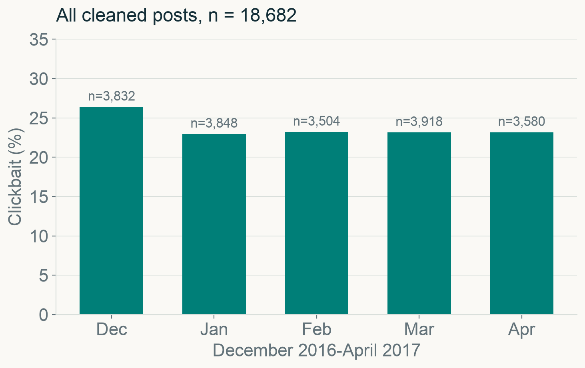

## Clickbait Without the Click {#s1 .cover background-color="#102d36" data-timing="15"}

<p class="cover-subtitle">Linguistic cues under temporal shift</p>

::: {.cover-author}
**Igor Kołodziej, Hubert Kowalski**<br>
**Adam Kaniasty, Mateusz Iwaniuk**

Warsaw University of Technology<br>
Supervisor Anna Wróblewska<br>
NLP mid-term · 18 November 2026
:::

::: notes
**00:00–00:15 · Presenter 1**

Given an English social-media teaser, can we predict whether human annotators labelled it clickbait? Our project, Clickbait Without the Click, tests that question on posts collected at different times.
:::

## Which cities? {#s2 data-timing="50"}

```{=html}
<figure class="teaser">
  <blockquote>“<mark>These</mark> cities will overthrow Silicon Valley as the new centers for tech in coming years:”</blockquote>
  <figcaption>April 2017 · <a href="https://aclanthology.org/C18-1127/">Webis-17 (Potthast et al., 2018)</a> · CC BY 4.0</figcaption>
</figure>
```

<p class="research-question">Do <strong>12 language cues</strong> improve later-month macro-F₁ over the <strong>same frozen embeddings</strong>?</p>

```{=html}
<div class="question-pair">
  <p>Does the gain recur across months?</p>
  <p>Which cue families contribute?</p>
</div>
```

::: notes
**00:15–01:05 · Presenter 1**

“These cities will overthrow Silicon Valley as the new centers for tech in coming years.” Which cities? The teaser promises a list without naming them. That gap can make readers curious. Similar wording also appears in ordinary news, so we use the dataset's human labels. Each system sees the teaser, the short message a reader sees before opening the link.

Our main question is whether twelve fixed language cues improve macro F-one on later posts when we keep the embeddings identical. We then ask whether that gain recurs across months and which groups of cues contribute.

**Sources and evidence (unspoken)**

Webis-17 post 848309004287791106, April test, CC BY 4.0. The prediction target is the public binary `truthClass`. [Potthast et al., 2018](https://aclanthology.org/C18-1127/).
:::

## What prior work tells us {#s3 data-timing="50"}

```{=html}
<div class="evidence-pair">
  <article>
    <h3>Explicit signals</h3>
    <p><strong>Potthast et al. (2016)</strong></p>
    <p>A random forest used measurable wording and style in publisher tweets.</p>
    <p class="implication">Wording gives us cues we can define and inspect.</p>
  </article>
  <article>
    <h3>Learned representations</h3>
    <p><strong>Zhou (2017) · Indurthi et al. (2020)</strong></p>
    <p>Attention and transformer representations supported clickbait-strength prediction in the official challenge.</p>
    <p class="implication">A learned representation gives us a baseline for binary detection.</p>
  </article>
</div>
```

::: notes
**01:05–01:55 · Presenter 1**

Potthast and colleagues showed that observable properties of publisher tweets can help a random forest detect clickbait. Their work gives us a reason to test cues whose definitions we can inspect.

Zhou's attention model won the 2017 challenge, and Indurthi and colleagues later used transformers to improve strength prediction. That benchmark asked how clickbait-like a post is. Their results use the official challenge test. Our April posts come from the public labelled training release, and our target is its binary label. We take a learned representation as our baseline, freeze it, and measure what the explicit cues add.

**Sources and evidence (unspoken)**

[Potthast et al., 2016](https://downloads-cf.webis.de/publications/papers/potthast_2016b.pdf), [Zhou, 2017](https://arxiv.org/abs/1710.05364), [official challenge overview](https://arxiv.org/abs/1812.10847), [Indurthi et al., 2020](https://aclanthology.org/2020.coling-main.425/). The official challenge was ranked by mean squared error on clickbait strength. Its test is separate from this project's April split of the public labelled training release.
:::

## What our experiment adds {#s4 data-timing="70"}

<p class="lead"><a href="https://arxiv.org/html/2602.18171v1#S4.SS4">Michaluk et al. (2026)</a> combined OpenAI embeddings and 15 features with XGBoost.</p>

| Design choice | Michaluk et al. | This study |
|---|---|---|
| Embedding control | 3,072 dimensions for embeddings alone, 1,000 in the hybrid | **Identical 384 coordinates** and shared classifier family and grid |
| Generalization | Balanced mixed-source headlines, random 80/10/10 split | **Later-month tests**, grouped-random diagnostics and an overlap audit |
| Cue contribution | Fifteen features evaluated together | **Paired C−B**, uncertainty and four cue-family removals |

<p class="takeaway">A chronological split tests performance on later posts. Publisher IDs are unavailable.</p>

::: notes
**01:55–03:05 · Presenter 1**

Michaluk and colleagues show that a hybrid can work. Their model combines OpenAI embeddings with fifteen explicit features and uses boosted decision trees. Their reported ablation changes embedding size as well as adding features. We keep the vectors identical for our embedding and hybrid systems and give both the same classifier family and tuning budget.

Søgaard and colleagues show why a shuffled split can give optimistic results. We measure the cue gain across later months and use grouped random splits as a diagnostic. Grouping keeps posts with the same normalized title together in those diagnostics. We audit overlap across partitions and remove one cue family at a time to learn where the gain comes from. Our data lacks publisher IDs, so the chronological test tells us about later posts from this collection.

**Sources and evidence (unspoken)**

[Michaluk et al., 2026, Table 4](https://arxiv.org/html/2602.18171v1#S4.SS4), [Søgaard et al., 2021](https://aclanthology.org/2021.eacl-main.156/), [Röttger and Pierrehumbert, 2021](https://aclanthology.org/2021.findings-emnlp.206/), [Broscoțeanu and Ionescu, 2023](https://aclanthology.org/2023.findings-emnlp.640/). Grouped-random diagnostics, uncertainty and cue-family removals are planned. Exact main-window overlap checks are complete.
:::

## The A/B/C pipeline {#s5 data-timing="70"}

<p class="status">Completed PoC · main chronological window</p>

```{=html}
<div class="data-flow" aria-label="Join Webis-17 records by ID, audit exact matches, assign chronological splits, and extract the English teaser">
  <span>Webis-17</span><span aria-hidden="true">→</span>
  <span>ID join, cleaning and exact audit</span><span aria-hidden="true">→</span>
  <span>Split manifest</span><span aria-hidden="true">→</span>
  <span>English teaser</span>
</div>
```

```{=html}
<div class="model-flow" role="group" aria-label="All branches use the same teaser. A uses TF-IDF, B uses frozen MiniLM, and C uses those same embeddings with 12 teaser cues. Each branch fits its own logistic regression model.">
  <div class="flow-node tfidf-node"><strong>Word + character TF-IDF</strong><span>Word 1–2 and character 3–5 n-grams</span></div>
  <div class="flow-node minilm-node"><strong>Frozen MiniLM</strong><span>Shared 384 embedding coordinates</span></div>
  <div class="flow-link link-a" aria-hidden="true"></div>
  <div class="flow-link link-b" aria-hidden="true"></div>
  <div class="flow-link link-c"><span>+12 teaser cues</span></div>
  <div class="flow-node model-a"><strong>A · Lexical baseline</strong><span>Logistic regression</span></div>
  <div class="flow-node model-b"><strong>B · Embedding baseline</strong><span>Logistic regression</span></div>
  <div class="flow-node model-c"><strong>C · Controlled hybrid</strong><span>Logistic regression</span></div>
</div>
```

```{=html}
<div class="takeaway pipeline-footer">
  <p><strong>Shared settings</strong> · Balanced L2, same five regularization values</p>
  <p><strong>Shared April test</strong> · Macro-F₁</p>
</div>
```

::: notes
**03:05–04:15 · Presenter 1**

In the proof of concept, we join the released labels to teasers by ID, clean and audit the data, and use a recorded chronological split. Each system sees the same teaser text.

System A weights word and character patterns with TF-IDF. B uses MiniLM to turn a teaser into a fixed vector of three hundred and eighty-four numbers. C takes that exact vector and appends twelve cue values from the same teaser. Each system fits its own logistic regression using the same five regularization options. We give more weight to the less frequent clickbait class during fitting. The common representation lets us test what the twelve cues add to B. A gives us a separate lexical benchmark using the same posts.

**Sources and evidence (unspoken)**

[all-MiniLM-L6-v2](https://huggingface.co/sentence-transformers/all-MiniLM-L6-v2). A uses word 1–2 and character 3–5 TF-IDF. Grid `C = [0.01, 0.1, 1, 10, 100]`. Select by March validation macro-F₁, breaking ties in favour of the smallest C. Final training and fitted transforms use train only. The embeddings are cached without label supervision or dataset-fitted transforms.
:::

## What a cue measures {#s6 data-timing="45"}

```{=html}
<figure class="teaser cue-example">
  <blockquote>“<mark>How</mark> does <mark class="mint-mark">your</mark> brain handle virtual reality<mark>?</mark>”</blockquote>
  <figcaption>March 2017 · <a href="https://aclanthology.org/C18-1127/">Webis-17 (Potthast et al., 2018)</a> · CC BY 4.0</figcaption>
</figure>
```

```{=html}
<div class="cue-key">
  <span><mark>How … ?</mark> Question hook fires</span>
  <span><mark class="mint-mark">your</mark> Direct address matches 1 of 7 tokens</span>
</div>
```

```{=html}
<div class="cue-families">
  <div><strong>Referential withholding</strong><span>Opening pointers</span></div>
  <div><strong>Audience involvement</strong><span>Questions and direct address</span></div>
  <div><strong>Affective and narrative framing</strong><span>Surprise and reversal</span></div>
  <div><strong>Specificity and presentation</strong><span>Numbered promises and punctuation</span></div>
</div>
```

::: notes
**04:15–05:00 · Presenter 1**

Here is a March teaser. “How does your brain handle virtual reality?” It starts with “how” and contains a question mark, so the question hook fires. The word “your” matches one of seven tokens for direct address.

The twelve cues cover four families. They describe how a teaser withholds information, involves the reader, frames a story, or packages a promise. Ordinary reporting can use these patterns too. Now let's see what happened when we ran these models on later posts.

**Sources and evidence (unspoken)**

Webis-17 post 837668396816728064, March validation, CC BY 4.0. The extractor also gives this teaser nonzero attention punctuation. The four families and complete definitions follow the proposal's Appendix A and `docs/cues.md`.
:::

## What entered the PoC {#s7 data-timing="60"}

```{=html}
<div class="cleaning-flow">
  <div><strong>19,538</strong><span>Raw rows joined by ID</span></div>
  <div><strong>19,484</strong><span>−54 empty teasers</span></div>
  <div><strong>19,073</strong><span>−411 repeated teasers</span></div>
  <div><strong>18,682</strong><span>−391 repeated normalized titles</span></div>
</div>
```

```{=html}
<div class="evidence-layout">
  <figure class="eda-chart">
    
  </figure>
  <div class="evidence-copy">
    <p><strong>23.8% clickbait</strong> in the cleaned Webis-17 pilot.</p>
    <p>Median length is <strong>10 words</strong> for clickbait teasers and <strong>12</strong> for the other teasers.</p>
    <p><strong>Zero exact overlaps</strong> of IDs, normalized teasers or normalized titles across main partitions.</p>
    <p class="muted">Near-duplicate audit pending.</p>
  </div>
</div>
```

::: notes
**05:00–06:00 · Presenter 2**

We started from the public labelled Webis-17 release. After joining texts and labels, we removed empty and repeated teasers. That left nineteen thousand and seventy-three posts. A further three hundred and ninety-one shared a normalized article title with an earlier retained post. Every exclusion is recorded in the ledger.

About twenty-four percent of the cleaned posts are labelled clickbait. The chart shows that December has the largest positive share. In the cleaned corpus, the median teaser length is ten words for clickbait and twelve for the other class.

Our main partitions share zero exact IDs, normalized teasers, or normalized titles. We use titles as a proxy for articles, so related articles with different titles need a separate check. That near-duplicate audit is still pending.

**Sources and evidence (unspoken)**

[Public Webis-17 training release](https://zenodo.org/records/5530410), CC BY 4.0. `results/poc/main/data_audit.json`, `exclusion_ledger.csv` and `summary.json`. Median lengths use whitespace word counts over all cleaned rows, as in the length histogram. Titles are a proxy for article identity.
:::

## Train, validate, test {#s8 data-timing="50"}

```{=html}
<div class="timeline">
  <div class="timeline-step">
    <h3>Train</h3>
    <p>Dec 2016–Feb 2017</p>
    <strong>11,184 posts</strong>
    <p>Fit TF-IDF, cue scaling and classifiers</p>
  </div>
  <div class="timeline-step">
    <h3>Validate</h3>
    <p>Mar 2017</p>
    <strong>3,918 posts</strong>
    <p>Select regularization by macro-F₁</p>
  </div>
  <div class="timeline-step">
    <h3>Test</h3>
    <p>Apr 2017</p>
    <strong>3,580 posts</strong>
    <p>23.2% clickbait · compare the same posts</p>
  </div>
</div>
```

<p class="research-question"><strong>Primary</strong> · Macro-F₁ and paired C−B</p>
<p class="muted">Also measured in April · Positive-class scores, average precision and Brier score</p>

::: notes
**06:00–06:50 · Presenter 2**

We train on December through February, select regularization in March, and score the resulting systems on April. The training rows determine the TF-IDF vocabulary and how we scale the cues. The MiniLM encoder stays frozen.

About twenty-three percent of April posts are positive. Macro F-one gives both classes equal weight by averaging their two F-one scores. Our primary comparison subtracts B's score from C's on exactly the same April posts. We also measure positive-class precision and recall, average precision, and Brier score. Later, we will use reliability diagrams to compare predicted probabilities with observed rates.

**Sources and evidence (unspoken)**

`results/poc/main/protocol.json`, `summary.json` and `artifacts/results_table.csv`. The public labelled release supplies all three partitions. The official challenge test remains restricted and outside the experiment.
:::

## April results {#s9 data-timing="65"}

<p class="lead">April 2017 test · 3,580 posts · 830 positive (23.2%)</p>

```{=html}
<div class="results-layout">
  <div class="score-chart" role="group" aria-label="April test macro-F1. A, TF-IDF, 0.7479. B, MiniLM, 0.7111. C, MiniLM plus cues, 0.7374.">
    <p class="chart-title">Macro-F₁</p>
    <div class="score-axis" aria-hidden="true"><span>0</span><span>0.25</span><span>0.50</span><span>0.75</span><span>1.00</span></div>
    <div class="score-row score-a"><strong>A · TF-IDF</strong><div class="score-track"><div class="score-bar" style="--score: 74.7911%"><span>0.7479</span></div></div></div>
    <div class="score-row score-b"><strong>B · MiniLM</strong><div class="score-track"><div class="score-bar" style="--score: 71.1133%"><span>0.7111</span></div></div></div>
    <div class="score-row score-c"><strong>C · MiniLM + cues</strong><div class="score-track"><div class="score-bar" style="--score: 73.7411%"><span>0.7374</span></div></div></div>
  </div>
  <div class="result-callout">
    <p>Paired C−B</p>
    <p class="delta">+2.63</p>
    <p>percentage points</p>
    <p class="result-limit">One window<br>Paired interval pending</p>
  </div>
</div>
```

<p class="takeaway">Same test posts · Saved predictions · Reproduced in a fresh environment</p>
<p class="muted">April was held out from fitting and selection in this run. An earlier pilot had already scored April.</p>

::: notes
**06:50–07:55 · Presenter 2**

The pipeline ran end to end on real posts. It saved predictions for all three systems on the same test rows. A fresh environment reproduced the results. The repository includes the predictions and the commands for running the experiment.

Adding the cues raised April macro F-one by two point six three percentage points over the MiniLM baseline. TF-IDF had the highest macro F-one in this window.

April was held out from fitting and regularization selection in this run. We had seen earlier April pilot scores, so we treat this as preliminary. We have a point estimate from one window, with the paired interval still to come.

**Sources and evidence (unspoken)**

`results/poc/main/summary.json`, `predictions.parquet` and `reproduction.json`. April 2017 macro-F₁ A 0.747911, B 0.711133, C 0.737411. Compute C−B from unrounded scores.
:::

## What changed on individual posts? {#s10 data-timing="45"}

<p class="lead">Two model disagreements · April 2017 test · <a href="https://aclanthology.org/C18-1127/">Webis-17 (Potthast et al., 2018)</a> · CC BY 4.0</p>

```{=html}
<div class="example-pair">
  <article>
    <h3>Corrected error</h3>
    <blockquote>“<mark>These</mark> cities will overthrow Silicon Valley as the new centers for tech in coming years:”</blockquote>
    <dl><dt>Corpus label</dt><dd>Clickbait</dd><dt>B</dt><dd>Non-clickbait</dd><dt>C</dt><dd>Clickbait</dd></dl>
  </article>
  <article>
    <h3>Introduced false positive</h3>
    <blockquote>“<mark>Here</mark> are the best TV shows and movies coming to Netflix, Amazon and more in April”</blockquote>
    <dl><dt>Corpus label</dt><dd>Non-clickbait</dd><dt>B</dt><dd>Non-clickbait</dd><dt>C</dt><dd>Clickbait</dd></dl>
  </article>
</div>
```

<p class="takeaway">In April, C corrected <strong>162</strong> B errors and introduced <strong>80</strong>.</p>

::: notes
**07:55–08:40 · Presenter 2**

The first example is the teaser we opened with. B missed it and C correctly flagged it. On the right, the post recommends shows and movies. The corpus label is non-clickbait, and C introduces a false positive. Both posts trigger the opening-pointer cue. These are two examples of what changes when we fit the full hybrid model.

Across the April test, C corrected a hundred and sixty-two errors that B made and introduced eighty new errors. We will use such disagreements to guide a systematic error analysis.

**Sources and evidence (unspoken)**

`presentation/assets/selected_examples.csv`, Webis-17 posts 848309004287791106 and 847999744609832960. Counts recomputed from `results/poc/main/predictions.parquet`: 162 with B wrong and C correct, 80 with B correct and C wrong. The examples illustrate model disagreements and support no attribution to an individual cue.
:::

## What will test H1–H4? {#s11 data-timing="50"}

<p class="status">Planned · full study</p>

```{=html}
<div class="next-layout">
  <dl class="hypotheses">
    <dt>H1 · Cue gain</dt><dd>Paired bootstrap interval for April C−B</dd>
    <dt>H2 · Persistence</dt><dd>February, March and April tests plus three article-grouped random diagnostics</dd>
    <dt>H3 · Cue families</dt><dd>Four family removals and at least 20 categorized errors</dd>
  </dl>
  <div class="context-card">
    <h3>H4 · Article relations <small>Secondary experiment</small></h3>
    <p>Same rows, teaser, title and 96-word-token article excerpt</p>
    <p class="context-equation"><strong>C<sub>ctx</sub></strong> <span aria-hidden="true">→</span> <strong>D<sub>ctx</sub></strong></p>
    <p><strong>Add three cues</strong> · Content-word overlap, missing teaser entities, embedding similarity</p>
    <p class="muted"><a href="https://aclanthology.org/2020.ccl-1.106/">Title–body interaction: Wu et al. (2020)</a></p>
  </div>
</div>
```

<p class="takeaway">Compare probability calibration with test prevalence in view.</p>

::: notes
**08:40–09:30 · Presenter 2**

Next, we will estimate uncertainty around the April gain, then check whether it recurs in February and March and how it compares with grouped random splits. We will remove one cue family at a time, examine at least twenty categorized errors, and check calibration alongside class prevalence.

Wu and colleagues motivate our context study. Both systems get the same posts, teasers, titles and the first ninety-six word tokens from available article paragraphs. Both already use the twelve teaser cues. D adds three measurements of how the teaser relates to that excerpt.

**Sources and evidence (unspoken)**

[Wu et al., 2020](https://aclanthology.org/2020.ccl-1.106/). H4 tests macro-F₁(D_ctx) − macro-F₁(C_ctx). Both systems receive the same article-complete rows and partitions. R1 is teaser content-word overlap with the lead, R2 is the fraction of teaser named entities missing from the lead, and R3 is MiniLM cosine similarity. The full context suite also includes A_ctx and B_ctx.
:::

## Before the Phase 2 checkpoint {#s12 .closing background-color="#102d36" data-timing="30"}

```{=html}
<div class="checkpoint">
  <div><h3>Data audit</h3><p>Review near-duplicates across partitions.</p></div>
  <div><h3>Experiment plan</h3><p>Second method class under selection. Fine-tuned DistilBERT is one candidate.</p></div>
</div>
```

<p><strong>External diagnostic</strong> · Webis-16 after schema, label and overlap checks</p>
<p><strong>Optional</strong> · Jeff-Qwen3.5 and YTClickbait21K titles</p>

<p class="closing-question">How should we validate near-duplicate detection when related articles have different titles?</p>

::: notes
**09:30–10:00 · Presenter 2**

Before Phase Two, our priorities are near-duplicate checking and selecting an additional method class. A fine-tuned encoder on the same teaser splits is one candidate. Webis-16 transfer also needs schema, label and overlap checks. For the Q-and-A, we'd like feedback on validating near-duplicate detection when related articles have different titles. Thank you.

**Sources and evidence (unspoken)**

Phase 2 deadline 2 December 2026. A compact fine-tuned encoder such as DistilBERT is a candidate for Criterion 2.3, subject to team adoption. Proposed protocol uses the same teasers and manifest, trains on December–February, selects settings on March and fixes them before April evaluation. All existing PoC models use logistic regression. [Webis-16 release](https://zenodo.org/records/3251557) (2,992 tweets, 25.6% positive in the public corpus), [Jeff-Qwen3.5](https://github.com/firelex/jeff), [YTClickbait21K](https://doi.org/10.6084/m9.figshare.31891576). Jeff and YouTube titles remain optional under the proposal.
:::

## Appendix · Twelve teaser cues {#b-cues .backup data-timing="0"}

```{=html}
<div class="cue-appendix">
  <div>
    <h3>Referential withholding</h3>
    <ul>
      <li><strong>Initial pointer</strong> · First token matches the pointer list.</li>
      <li><strong>Indefinite referents</strong> · Share of tokens matching the indefinite list.</li>
      <li><strong>Delayed revelation</strong> · A listed phrase occurs, such as “here's why”.</li>
    </ul>
  </div>
  <div>
    <h3>Audience involvement</h3>
    <ul>
      <li><strong>Direct address</strong> · Share of tokens matching the address list.</li>
      <li><strong>Action invitation</strong> · Listed opening token or opening “find out”.</li>
      <li><strong>Question hook</strong> · Listed opening question token and a question mark.</li>
    </ul>
  </div>
  <div>
    <h3>Affective and narrative framing</h3>
    <ul>
      <li><strong>Surprise</strong> · Share of tokens matching the surprise list.</li>
      <li><strong>Epistemic distance</strong> · Share matching cautious terms such as “reportedly”.</li>
      <li><strong>Narrative reversal</strong> · A listed reversal phrase occurs.</li>
    </ul>
  </div>
  <div>
    <h3>Specificity and presentation</h3>
    <ul>
      <li><strong>Numbered payoff</strong> · Integer 1–99 in the first two tokens, then a payoff word within four tokens.</li>
      <li><strong>Attention punctuation</strong> · Exclamation marks, question marks and ellipsis events per character, capped at 1.</li>
      <li><strong>Referent–anchor imbalance</strong> · P / (P + A + 1), where P counts listed referents and A counts non-initial capitalized tokens excluding all-caps.</li>
    </ul>
  </div>
</div>
```

::: notes
Backup slide. See the proposal's Appendix A, `docs/cues.md` and `resources/linguistic_cues.json` for normalization, exact lexicons, denominators and implementation rules.
:::

## Appendix · April metrics and compute {#b-metrics .backup data-timing="0"}

<p class="lead">April 2017 test · 3,580 posts · 830 clickbait (23.2%)</p>

| System | Macro-F₁ | Clickbait precision | Clickbait recall | Clickbait F₁ | Average precision | Brier |
|---|---:|---:|---:|---:|---:|---:|
| A · TF-IDF | **0.7479** | 0.615 | 0.610 | 0.612 | 0.650 | **0.132** |
| B · MiniLM | 0.7111 | 0.498 | 0.707 | 0.584 | 0.652 | 0.160 |
| C · MiniLM + cues | 0.7374 | 0.533 | 0.741 | **0.620** | **0.674** | 0.151 |

```{=html}
<div class="metrics-detail">
  <p><strong>Also available</strong> · April confusion matrices and saved probabilities.</p>
  <p><strong>Planned</strong> · Reliability diagrams, paired uncertainty and comparison with each test's prevalence.</p>
  <p><strong>Measured PoC cost</strong> · 8.024 s runner, including 0.582 s April inference, and 718.6 MiB peak process RSS. Apple M3 Max, thread limits 4, cached embeddings.</p>
  <p class="muted">Runner time includes reconciliation, fitting, scoring and export after imports. Downloads and embedding generation are excluded.</p>
</div>
```

::: notes
Backup slide. `results/poc/main/summary.json` and `artifacts/results_table.csv`. Brier score is lower when probability predictions have lower squared error. Reliability diagrams are future work. Inference time includes cached-feature preparation and model prediction. Peak RSS is process-wide. The root README gives reproduction commands and the full summary contains per-system fit times.
:::

## Appendix · Selected literature evidence {#b-sota .backup data-timing="0"}

| Work | Method and input | Corpus and evaluation | Published measure |
|---|---|---|---|
| [Potthast et al. (2016)](https://downloads-cf.webis.de/publications/papers/potthast_2016b.pdf) | Random forest, explicit cues | Webis-16 · random 2:1 split, test | ROC-AUC 0.79 |
| [Biyani et al. (2016)](https://ojs.aaai.org/index.php/AAAI/article/view/9966) | Boosted trees, title/body/URL | Yahoo news · 3,000 train, 1,073 test | Weighted F₁ 0.749, positive F₁ 0.603 |
| [Zhou (2017)](https://arxiv.org/abs/1710.05364) | Attention and recurrent network, post | Clickbait Challenge 2017 · official test | Strength MSE 0.033 |
| [Indurthi et al. (2020)](https://aclanthology.org/2020.coling-main.425/) | Transformers and regression, post | Clickbait Challenge 2017 · official test | Strength MSE 0.0242 |
| [Wu et al. (2020)](https://aclanthology.org/2020.ccl-1.106/) | Style and co-attention, title/body | Challenge data · 2,495 development items used as test | Positive F₁ 0.733 |
| [Broscoțeanu and Ionescu (2023)](https://aclanthology.org/2023.findings-emnlp.640/) | Contrastive Ro-BERT, article | RoCliCo · 1,507 publisher-disjoint test rows | Macro-F₁ 0.9199 |
| [Michaluk et al. (2026)](https://arxiv.org/html/2602.18171v1#S4.SS4) | Embeddings and cues, headline | Balanced mixed sources · stratified 80/10/10, test | F₁ 0.864–0.909, averaging unspecified |

<p class="muted">MSE is mean squared error. Input fields, targets, evaluation splits and F₁ averaging differ across studies.</p>

::: notes
Backup slide. The revised proposal contains the fuller literature review and the methodological references on split design, temporal adaptation and calibration.
:::
