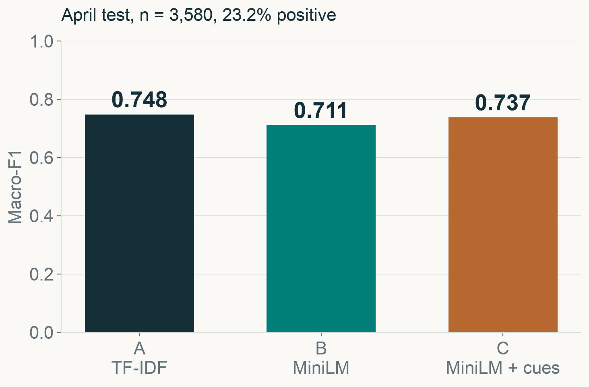

## Clickbait Without the Click {#s1 .cover background-color="#102d36" data-timing="25"}

Linguistic cues under temporal shift

When do interpretable language cues add value beyond learned representations, and does that value persist over time?

::: {.cover-author}
**Igor Kołodziej, Hubert Kowalski** 
**Adam Kaniasty, Mateusz Iwaniuk**

Warsaw University of Technology Supervisor: Anna Wróblewska 
NLP mid-term, 18 November 2026
:::

::: notes
**00:00-00:25 - Presenter 1**

Hello. Our project is Clickbait Without the Click. We ask whether simple language cues help a model detect clickbait, and whether that benefit lasts when we test on later posts. We will explain the problem, review existing approaches, and then present our study and first results.
:::

## Clickbait and the curiosity gap {#s2 data-timing="55"}

<blockquote>“<strong>These</strong> cities will overthrow Silicon Valley as the new centers for tech in coming years:”</blockquote>

:::: {.columns}
::: {.column width="50%"}
### What is withheld?

“**These cities**” points to an answer the teaser does not supply.

The promise of discovering that answer creates a **curiosity gap**.
:::
::: {.column width="50%"}
### What do we predict?

**English teaser → human clickbait label**

Ordinary news can use the same wording. Human judgments differ, and language and topics may change over time.
:::
::::

Can a detector distinguish informative reporting from language that withholds information to attract attention?

::: notes
**00:25-01:20 - Presenter 1**

Consider this teaser: “These cities will overthrow Silicon Valley as the new centers for tech in coming years.” Which cities? The text promises an answer without naming the cities. This creates a curiosity gap: readers need to open the article to learn the answer.

But detecting clickbait takes more than spotting certain words. Ordinary news can also use “these,” questions or emotional language. People may disagree about whether a post is clickbait. We classify English social-media teasers using the labels supplied with the dataset. We are not predicting clicks or checking facts. We also ask whether patterns learned from earlier posts still help on later ones.

**Sources and evidence (not spoken):**

Webis-17 example, post 848309004287791106, CC BY 4.0. Labels describe perceived clickbait, the task does not measure clicks, verify facts or generate spoilers. [Corpus: Potthast et al., 2018](https://aclanthology.org/C18-1127/).
:::

## Explicit linguistic features {#s3 data-timing="45"}

| Work | How it detects clickbait | Why it matters here |
|---|---|---|
| **Potthast et al., 2016** | Lexical/stylistic tweet cues → random forest | Observable wording can be predictive |
| **Biyani et al., 2016** | Article informality + title/body/URL features → boosted trees | Available article information changes the task |

Our question: do interpretable cues add information <strong>beyond embeddings</strong>, and does their contribution persist into later months?

::: notes
**01:20-02:05 - Presenter 1**

Early work uses explicit features of the text. Potthast and colleagues measure wording and style in publisher tweets, then use a random forest to classify them. Biyani and colleagues use boosted trees with information from the title, article body and URL, including how informal the article is.

These studies motivate our use of simple, readable cues. They also show why the available input matters: a model given an article has more information than one given only its teaser. We ask whether cues add value to a model that already uses learned text representations.

**Sources and evidence (not spoken):**

[Potthast et al.](https://doi.org/10.1007/978-3-319-30671-1_72): Webis-16 tweets. [Biyani et al.](https://ojs.aaai.org/index.php/AAAI/article/view/10388): Yahoo news stream. These studies use different corpora and input fields.
:::

## Learning patterns from text {#s4 data-timing="50"}

| Work | Main idea | Prediction setting |
|---|---|---|
| **Zhou, 2017** | Bidirectional GRU + token attention learns a tweet representation | Clickbait levels, Challenge 2017 winner |
| **Indurthi et al., 2020** | Transformer representations + boosted regression | Predict the strength of clickbait |

We use a <strong>frozen sentence encoder</strong> to ask what explicit cues add to an existing representation.

::: notes
**02:05-02:55 - Presenter 1**

Neural approaches learn patterns from text. Zhou's system uses a recurrent network that reads a tweet in both directions. Attention helps it focus on important words. It learns features without defining each one by hand, and won the 2017 Clickbait Challenge.

Indurthi and colleagues use transformer representations and boosted regression to predict clickbait strength. They ask how clickbait-like a post is, rather than only whether it is clickbait.

These studies motivate our embedding baseline. An embedding is a vector of numbers representing a text. We keep that representation fixed and ask what explicit cues add. Scores from different tasks and test sets are not directly comparable.

**Sources and evidence (not spoken):**

[Zhou](https://arxiv.org/abs/1710.05364), [Indurthi et al.](https://aclanthology.org/2020.coling-main.425/). Their official challenge results use different targets/partitions from our binary chronological test.
:::

## Michaluk et al.: our starting point {#s5 data-timing="50"}

**Their hybrid:** OpenAI embeddings + 15 linguistic features → XGBoost

Features describe wording and style, including pronouns and attention-grabbing punctuation.

| Comparison | Michaluk et al., 2026 | Our full study |
|---|---|---|
| Embedding comparison | 3,072-d embedding baseline vs 1,000-d hybrid | Same 384 embedding coordinates and LR family for B/C |
| Evaluation | Balanced mixed sources, random 80/10/10 split | Webis-17 chronological tests + grouped-random checks |
| Cue evidence | All 15 cues tested together | C−B uncertainty + four cue-group tests |

Our aim: isolate what cues add and test whether their benefit lasts over time.

::: notes
**02:55-03:45 - Presenter 1**

Michaluk and colleagues combine OpenAI embeddings with fifteen linguistic features and XGBoost. The features include pronouns and attention-grabbing punctuation. They evaluate headlines from mixed sources using a random split.

Their reported comparison changes embedding width as well as adding features. Our B and C models use exactly the same embedding vectors and classifier family, so the added cue block is the controlled difference. We will test that difference across later months and remove cue groups to see which help. Our contribution is a controlled test of cue value and its stability over time.

**Sources and evidence (not spoken):**

[Michaluk et al., *Click it or Leave it*](https://arxiv.org/html/2602.18171v1), Sections 3.2, 4.2 and Table 4. The published ablation changes embedding width alongside the cue block. Our proposed controls and temporal/family experiments extend this design. Published scores and our April macro-F1 are not directly comparable.
:::
## Title style and article context {#s6 data-timing="25"}

### Wu et al., 2020

Transformers learn title/body content and character-level title style. Co-attention models relationships between the texts.

**Our planned relation cues**

- Content-word overlap
- Teaser named entities missing from the article lead
- Embedding similarity between teaser and lead

Every compared model gets the same teaser, title and lead. We test what relation cues add beyond those inputs.

::: notes
**03:45-04:10 - Presenter 1**

Wu and colleagues study title style and title-body relationships using attention. This motivates our separate context experiment with word overlap, missing named entities and text similarity. Every compared model will receive the same teaser, title and article lead. We will test whether relation cues add further information.

**Sources and evidence (not spoken):**

[Wu et al., 2020](https://aclanthology.org/2020.ccl-1.106/). H4 is a planned matched-input comparison of D_ctx minus C_ctx, with twelve teaser cues already present in C_ctx. The shared lead is the first 96 word tokens.
:::
## Evidence for generalization {#s7 data-timing="50"}

| Evidence | What it tells us | Consequence for our design |
|---|---|---|
| **Søgaard et al., 2021** | Random splits can overestimate performance on new samples | Compare chronological and grouped-random tests |
| **Röttger & Pierrehumbert, 2021** | Capturing temporal language change need not improve the downstream task | Measure distribution changes and task effects separately |
| **RoCliCo, 2023** | Publisher-disjoint evaluation tests source transfer | Later-month testing does not establish unseen-publisher performance |

The open question: <strong>when and why does the added value of interpretable cues survive?</strong>

::: notes
**04:10-05:00 - Presenter 1**

How we split the data matters. Søgaard and colleagues show that random splits can give optimistic estimates of performance on new samples. We plan to compare later-month tests with random splits that keep posts linked to the same article together.

Röttger and Pierrehumbert found that extra pretraining on text from a specific period did not improve their classifier beyond pretraining on the same type of text. We therefore need to measure whether language changes affect our results.

RoCliCo tests articles from unseen publishers. Our data lacks publisher IDs, so later-month tests cannot establish that kind of transfer. Presenter Two will now explain our study.

**Sources and evidence (not spoken):**

[Søgaard et al.](https://aclanthology.org/2021.eacl-main.156/), [Röttger & Pierrehumbert](https://aclanthology.org/2021.findings-emnlp.206/), [Broscoțeanu & Ionescu](https://aclanthology.org/2023.findings-emnlp.640/). These studies motivate controls, they do not prove degradation in our corpus.
:::

## Our proposed study {#s8 data-timing="75"}

| System | Teaser representation | Classifier |
|---|---|---|
| **A - lexical baseline** | Word 1-2 and character 3-5 TF-IDF | Balanced L2 logistic regression |
| **B - embedding baseline** | Frozen MiniLM, 384 dimensions | Same LR family and tuning budget |
| **C - controlled hybrid** | **Exactly B's vectors + 12 cues** | Same LR family and tuning budget |

| Four families - three cues each | Examples |
|---|---|
| Referential withholding | Initial “these”, delayed revelation |
| Audience involvement | Direct address, action invitation |
| Affective / narrative framing | Surprise, cautious reporting, reversal |
| Specificity / presentation | Numbered payoff, punctuation, referent imbalance |

::: notes
**05:00-06:15 - Presenter 2**

We compare three systems. A uses TF-IDF, which weights word and character patterns, followed by logistic regression. B uses fixed MiniLM embeddings with logistic regression. C uses exactly the same embeddings as B and adds twelve cue values. All three use the same classifier family and five regularization settings to choose from.

The cues form four groups of three. They cover withheld information, direct reader involvement, emotional or narrative wording, and how specific or attention-grabbing the text is. Examples include an opening “these,” direct address, surprise words and promises such as “7 reasons”. A cue is a possible signal, not proof of clickbait.

We ask whether these cues improve B, whether the benefit lasts across months, and which groups matter. In the context experiment, every model will receive the same teaser, title and first ninety-six words of the article lead. We will test three extra relation cues beyond a baseline that already has the twelve teaser cues.

**Sources and evidence (not spoken):**

H1: C−B cue value - H2: stability across time - H3: family contributions - H4, secondary: relation value with matched context. Cue definitions are prespecified, transforms fit on training rows only. Frozen encoder: [all-MiniLM-L6-v2](https://huggingface.co/sentence-transformers/all-MiniLM-L6-v2).
:::

## Data and evaluation design {#s9 data-timing="55"}

Public Webis-17 training release - English teasers - official binary labels

| Partition | Calendar period | Posts | Purpose |
|---|---|---:|---|
| **Train** | Dec 2016-Feb 2017 | 11,184 | Fit representations, scalers and classifiers |
| **Validate** | Mar 2017 | 3,918 | Select regularization |
| **Test** | Apr 2017 | 3,580 | Compare A/B/C predictions |

**19,538 raw → 18,682 cleaned - 23.8% clickbait overall**

**Primary:** macro-F₁ and paired **C−B**. Full study: three chronological tests and three article-grouped random diagnostics.

::: notes
**06:15-07:10 - Presenter 2**

We use the public labelled Webis-17 training release, covering December 2016 to April 2017. We join texts and labels by ID, then remove empty teasers, repeated teasers and repeated article titles. This leaves eighteen thousand six hundred and eighty-two posts, with about twenty-four percent labelled clickbait.

We train on December through February, choose regularization using March, and test on three thousand five hundred and eighty April posts. We learn the TF-IDF vocabulary and cue scaling from training data only. Macro F-one averages the F-one scores of both classes. We compare C minus B on the same test posts. Two earlier time windows and three grouped random splits are planned. Webis-16 transfer checks remain unfinished.

**Sources and evidence (not spoken):**

[Webis-17](https://zenodo.org/records/5530410), CC BY 4.0. Public training release only, official restricted challenge test excluded. Grid: 0.01, 0.1, 1, 10, 100, train-only transforms/final fitting. Webis-16 external evaluation awaits compatibility and overlap checks.
:::

## PoC: cues improve B, A remains strongest {#s10 data-timing="60"}

:::: {.columns .result-columns}
::: {.column width="52%"}
{width=100% fig-alt="April macro-F1: A TF-IDF 0.7479, B MiniLM 0.7111, C MiniLM plus cues 0.7374. C exceeds B, A is strongest."}
:::
::: {.column width="48%"}
| System | April macro-F₁ |
|---|---:|
| A - TF-IDF | **0.7479** |
| B - MiniLM | 0.7111 |
| C - MiniLM + cues | 0.7374 |

C−B = +0.0263

Working pipeline: identical IDs, saved predictions and verified reproduction.

**One window, no paired interval yet.**
:::
::::

::: notes
**07:10-08:10 - Presenter 2**

The proof of concept saves predictions for all three models on the same test posts. Reloading the models reproduced those predictions. A separate run in a fresh environment with the same package versions also matched.

On April, A scores macro F-one zero point seven four seven nine. B scores zero point seven one one one. C scores zero point seven three seven four. Adding cues to B gives about two point six three percentage points.

So cues improve B in this run, but A remains strongest. This PoC covers one time window, and we have not calculated a confidence interval for the difference. April was excluded from training and model selection, but the team had already seen earlier pilot results on it. These findings are preliminary.

**Sources and evidence (not spoken):**

temporal_main/test, April 2017: n=3,580, clickbait=830 (23.2%). Source: `results/poc/main/summary.json`. April excluded from fitting/selection, but exposed in an earlier pilot. Preliminary point estimates, temporal robustness is untested.
:::

## Remaining experiments {#s11 data-timing="60"}

| Research question | Next experiment | Evidence sought |
|---|---|---|
| **H1 - Cue value** | Paired bootstrap interval for C−B | Uncertainty around the observed gain |
| **H2 - Persistence** | Three chronological tests + grouped-random diagnostics | Consistent effects versus split-dependent gains |
| **H3 - Families** | Four family removals, distributions, ≥20 categorized errors | Where each family helps or fails |
| **H4 - Relations** | Matched teaser/title/lead models, with/without relation cues | Incremental relation value |

**Also planned:** near-duplicate/cross-corpus audits and prevalence-aware calibration analysis.

::: notes
**08:10-09:10 - Presenter 2**

Next, we will calculate uncertainty for C minus B using paired bootstrap resampling of the test posts. We will compare the gain across all three time windows and the grouped random splits. A gain seen only in random splits would not show that it lasts over time.

We will also remove one cue group at a time, examine changes in cue values, and study at least twenty errors or model disagreements. The context experiment will compare models on the same posts and article text.

We still need to check near duplicates and cross-dataset overlap, and how well predicted probabilities match observed labels. For Phase Two, we still need a baseline from another classifier family. A Jeff language-model comparison and YouTube title tests remain optional.

**Sources and evidence (not spoken):**

Experiments listed here remain future work beyond the main-window PoC. Jeff and YouTube are supplementary. A feasible distinct decision-model family for Phase 2 still needs confirmation, current A/B/C classifiers all use LR.
:::

## Intended contribution and next checkpoint {#s12 .closing background-color="#102d36" data-timing="50"}

When do linguistic cues help? Does their value persist?

:::: {.columns}
::: {.column width="50%"}
### What we want to establish

Controlled cue gains, their uncertainty and family-level behaviour across time.

A separate, matched-input test of transparent teaser-article relations.

**Negative or unstable gains are informative.**
:::
::: {.column width="50%"}
### Before Phase 2 - 2 December

Strengthen the audit, experiments, revised SOTA and reproduction package.

Record and answer supervisor and Q&A feedback.

**Limits:** historical data, subjective labels, topic/time confounding, article proxies and no publisher IDs.
:::
::::

::: notes
**09:10-10:00 - Presenter 2**

We want to understand when simple language cues improve clickbait detection, which groups help, and whether their value lasts over time. Finding no benefit, or a benefit that changes between months, would still answer part of our question.

Our data is historical, and the labels reflect human judgment. Topics and language may change together. We use article titles to approximate article identity, and have no publisher IDs. These limits rule out claims about current deployment or unseen publishers.

Before December second, we will strengthen the experiments, data checks, literature review and reproduction instructions, and address supervisor and Q-and-A feedback. Thank you.

**Sources and evidence (not spoken):**

Q&A focus: are our chronological controls and article-identity proxy adequate for the claims we want to make?
:::
